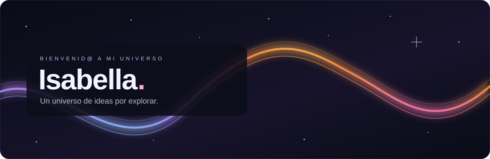

  

  <a href="https://github.com/isabella-crypto?tab=repositories">✦ Mis proyectos</a>
  &nbsp; · &nbsp;
  <a href="https://github.com/isabella-crypto?tab=stars">✧ Mis descubrimientos</a>

## Hola, soy Isabella ✨

**Desarrolladora web · Soporte TI**

Creo experiencias web modernas, funcionales y visualmente atractivas. Me interesan el desarrollo frontend, el diseño UI/UX y la optimización de interfaces, con especial atención al rendimiento y la experiencia móvil.

También trabajo en soporte TI: resolución de incidencias técnicas, configuración de equipos, administración de sistemas y soporte a usuarios.

### Mi universo de herramientas

| Área | Tecnologías y herramientas |
| --- | --- |
| Desarrollo web | Next.js · React · TypeScript · JavaScript · HTML · CSS |
| Diseño y prototipado | Figma |
| Control de versiones y despliegue | Git · GitHub · Vercel |
| Explorando | Cloudflare R2 · Integraciones mediante API · Modelado 3D · Herramientas de IA aplicadas al desarrollo |

### En órbita: Global Clinic 🪐

Uno de mis proyectos principales es **Global Clinic**, un sitio web corporativo con catálogo de productos médicos.

- Catálogo y fichas técnicas de productos.
- Componentes interactivos y diseño responsive.
- Despliegue en Vercel.

<!-- Añadir un enlace al proyecto cuando esté disponible para compartir. -->

### Cómo trabajo

Me gusta comprender cómo funcionan las tecnologías y aprender mientras desarrollo. Busco soluciones organizadas, escalables y fáciles de mantener, cuidando las buenas prácticas, la seguridad, el rendimiento, la compatibilidad móvil y la calidad visual.

  

---

Un pequeño universo de ideas por explorar.

